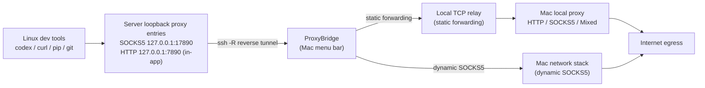

<div align="center">


# ProxyBridge

**Bring the Mac's local proxy to Linux servers from the menu bar, in one click**

[简体中文](README.md) | English

[](https://github.com/fejxc/ProxyBridge/actions/workflows/ci.yml)
[](https://github.com/fejxc/ProxyBridge/releases/latest)
[](LICENSE)


Through the system SSH it builds reverse tunnels so that development tools on your server (Codex, curl, pip, git …) can use the Mac's already-verified HTTP, SOCKS5 or Mixed proxy to reach the open internet. It also supports OpenSSH's native reverse dynamic SOCKS5, compatible with Clash Network Extension / TUN setups that have no local proxy port.

Remote AI coding (Codex, Claude Code and friends) is moving the main battlefield back to Linux servers, while the egress usually still lives on the Mac at hand: proxy clients, subscriptions and nodes are all local, and the server side has to be re-configured from scratch. ProxyBridge connects that inverted path — **zero install, zero config on the server; reuse the Mac's verified proxy egress directly**. Credentials never leave the Mac, disconnections self-heal, and status is reported honestly.

[Download the latest release](https://github.com/fejxc/ProxyBridge/releases/latest) · [Changelog](CHANGELOG.md) · [Report an issue](https://github.com/fejxc/ProxyBridge/issues)

</div>

## Contents

- [Features](#-features)
- [Requirements](#-requirements)
- [Installation](#-installation)
- [Quick start](#-quick-start)
- [Connection modes](#-connection-modes)
- [Using on Linux](#-using-on-linux)
- [Real-time traffic statistics](#-real-time-traffic-statistics)
- [How it works](#-how-it-works)
- [Building from source](#-building-from-source)
- [Project docs](#-project-docs)
- [FAQ](#-faq)
- [Security notes](#-security-notes)
- [Contributing](#-contributing)
- [License](#-license)

## ✨ Features

### Connection & tunneling

- Builds a real `ssh -R` tunnel via the system `/usr/bin/ssh`; remote listeners bind to the server's own `127.0.0.1` only.
- Three connection modes: automatic (recommended), classic static port forwarding, and OpenSSH native reverse dynamic SOCKS5. Automatic mode probes the local entry first and falls back to dynamic SOCKS5 when none is available.
- Dynamic local proxy endpoint following: after a port drift or proxy-client restart, the new endpoint is probed and the forwarding target switches over seamlessly — the SSH tunnel itself is never interrupted — and the remote side is re-verified under the new protocol; a failed local verification triggers an active rescan.
- Upstream proxy authentication: when your local proxy requires credentials, fill them in per server (the password goes to the macOS Keychain); the HTTP compat entry and connection probes answer the auth automatically (SOCKS5 RFC 1929 / HTTP Basic) with zero changes on the Linux side.
- SSH hosts accept IPv4, hostnames and IPv6 literals (stored bare, displayed with brackets).
- Node-switch awareness: the egress IP fingerprint is observed through the local proxy; a changed IP triggers automatic re-verification of active tunnels.

### Self-healing

- Automatic reconnect on non-manual disconnects (on by default): network failures retry with 1, 2, 4… second backoff up to 60 seconds; network restoration and sleep/wake rebuild immediately; local / remote / relay port conflicts retry inside a 3-minute window, and remote conflicts support read-only diagnosis of the holding process over SSH.
- Auto-repair (independent of auto-reconnect): when the connection is up but the business path keeps failing inside the evidence window, the tunnel is rebuilt automatically — even for servers with auto-reconnect turned off.
- After automatic mode falls back to dynamic SOCKS5, a recovered local proxy switches back to static forwarding on its own.
- Single-instance protection and cleanup of orphaned ssh processes after a crash, so no double app or leftover tunnel steals ports.

### Security & privacy

- SSH is forced to `StrictHostKeyChecking=yes`; the first connection verifies and trusts the host fingerprint inside the app (no terminal needed), and changed host keys never offer a one-click override; servers can be imported from `~/.ssh/config` (Include directives expanded).
- Upstream protocols: HTTP, SOCKS5, Mixed. Authentication: password, ssh-agent, or a specific identity file. Passwords are delivered through OpenSSH's native SSH_ASKPASS mechanism (never on the command line, in environment variables or logs); "Remember" stores them in the macOS Keychain; after successful auth the password is remembered in-session so auto-reconnects don't ask again.
- Logs are redacted; passwords, key contents and full auth material are never recorded.

### Observability

- Layered status: the actual connection mode, SSH, Mac egress, Linux SOCKS5, HTTP CONNECT verification and error causes are shown separately. The remote proxy is only reported working after a real request passes through it, and the Clash egress node is marked unconfirmed on its own.
- Each server can define a business probe URL; the "connected" verdict names the actual target it verified.
- Static forwarding provides live traffic stats and rate curves (see [below](#-real-time-traffic-statistics)); lifetime totals persist per server on this Mac and survive restarts.
- Logs are written to `~/Library/Logs/ProxyBridge/app.log` (rotated past 2 MB); one click exports a redacted diagnostics bundle in-app.

### Experience

- In-app auto-update: streamed download + independent signature integrity checks + atomic replacement; any failed check refuses to install and rolls back.
- Launch update check (read-only GitHub public API), login item, connect-at-launch per server, connection failure notifications, optional "prevent idle sleep while connected".
- A Codex HTTP compat entry is provided on Linux `127.0.0.1:7890` by default, implemented inside the Mac app (zero server dependencies — nothing to install). The app never uses sudo and never modifies system config; the entry can be disabled per server.
- UI in Chinese / English (static copy fully translated; service-layer event details and logs remain Chinese).

## 📦 Requirements

| Side | Requirement |
|---|---|
| Mac | macOS 14 or later, Apple Silicon or Intel |
| Mac-side proxy | A locally verified HTTP / SOCKS5 / Mixed loopback entry; with Clash Network Extension / TUN (no local port), use dynamic SOCKS5 |
| Linux server | An SSH-loginable regular user account; `curl` (for real probes). The HTTP compat entry is implemented in-app — zero server dependencies |
| Build only | Full Xcode 15+, or Command Line Tools only (Swift 6.0 compiler), see [Building from source](#-building-from-source) |

## 🚀 Installation

**Option 1: Homebrew**

```bash
brew install fejxc/tap/proxybridge
```

While the app is not notarized, Homebrew installs carry the quarantine flag. If the first launch is blocked, run `xattr -dr com.apple.quarantine /Applications/ProxyBridge.app`. Use the in-app self-updater for new versions (it verifies the official sha256 before an atomic replacement) — **do not use `brew upgrade`**, which would downgrade back to the tap's recorded version.

**Option 2: manual download**

1. Download `ProxyBridge-<version>-universal.dmg` (universal for Apple Silicon and Intel) from [Releases](https://github.com/fejxc/ProxyBridge/releases/latest).
2. Open the DMG and drag **ProxyBridge.app** into Applications, then launch it.
3. If macOS blocks the launch, confirm the file came from this repository's Release and allow it under System Settings → Privacy & Security, following [Apple's official instructions](https://support.apple.com/102445).

> The app is currently ad-hoc signed and not notarized by Apple. Every Mac configures its own proxy and servers; the package contains no configuration, passwords or keys.

## ⚡ Quick start

1. For classic static forwarding, start your proxy client on the Mac first and confirm an HTTP, SOCKS5 or Mixed loopback entry is available; with Clash Network Extension / TUN, pick "Dynamic SOCKS5" directly.
2. Launch ProxyBridge, add a server and choose the auth mode (or import from `~/.ssh/config`). Hosts may be IPv4, a hostname or an IPv6 literal. Verify the fingerprint either way:
   - On first connect, follow the in-app guide to verify the fingerprint and write it into `known_hosts` (recommended — no terminal needed);
   - Or log in manually from a terminal once:

   ```bash
   ssh -p <SSH port> <username>@<server address>
   ```

3. Click "Connect". The app shows the mode actually chosen and verifies the proxy entry with a real request from the Linux server. Dynamic SOCKS5 verifies Linux SOCKS through to the Mac egress — that alone does not confirm which Clash rule or node matched, so cross-check in Clash's "Activity" view.
4. On the server, export the environment variables from [Using on Linux](#-using-on-linux) and start working.

> "Connect at launch" and "launch at login" are two independent options: the former decides which servers connect when the app starts, the latter whether the app starts with macOS. Login items and notifications both need system-granted permission.

## 🔗 Connection modes

| Mode | Data path | Linux proxy address |
|---|---|---|
| Automatic (recommended) | Prefers a truly verified local upstream; otherwise tries OpenSSH reverse dynamic SOCKS5 | Codex HTTP `127.0.0.1:7890` (default); SOCKS5 `127.0.0.1:17890` |
| Static forwarding | Linux loopback → SSH `-R remote:local` → Mac's HTTP/SOCKS/Mixed upstream | `remotePort`, per the upstream protocol |
| Dynamic SOCKS5 | Linux SOCKS5 → SSH `-R 127.0.0.1:port` → Mac network stack | SOCKS5 `127.0.0.1:17890` |

Dynamic mode uses `ssh -R 127.0.0.1:<port>`; the Mac needs no local HTTP/SOCKS listener, and the remote SOCKS5 is TCP-only.

## 🐧 Using on Linux

Once connected, export environment variables on the server to route dev tools through the Mac proxy. The HTTP compat entry is enabled by default; the underlying SOCKS5 uses the separate port `17890`, while Codex and other HTTP clients keep using `7890`:

```bash
export http_proxy=http://127.0.0.1:7890
export https_proxy=http://127.0.0.1:7890
export HTTP_PROXY=http://127.0.0.1:7890
export HTTPS_PROXY=http://127.0.0.1:7890
export NO_PROXY=localhost,127.0.0.1,::1
curl -I --proxy http://127.0.0.1:7890 \
  --connect-timeout 8 --max-time 20 https://api.openai.com/v1/models
```

Unauthenticated APIs usually answer HTTP 401 — that proves the request reached the API, not that the account is authenticated. ProxyBridge verifies HTTP CONNECT separately.

The HTTP entry is implemented by ProxyBridge on the Mac side (carried over the SSH reverse tunnel), so the server needs neither Privoxy nor any other software; the remote SSH forwarding binds to `127.0.0.1` only. On port conflicts, change the port in the server editor — the app never kills unknown processes; the HTTP entry can be disabled per server.

SOCKS5 only (curl example):

```bash
curl --socks5-hostname 127.0.0.1:17890 -I \
  --connect-timeout 8 --max-time 20 https://api.openai.com/v1/models
```

To reproduce the dynamic SOCKS5 tunnel by hand on the Mac (start it first, then substitute your SSH details and port):

```bash
ssh -N -T -o BatchMode=yes -o StrictHostKeyChecking=yes \
  -o ExitOnForwardFailure=yes -o ServerAliveInterval=30 -o ServerAliveCountMax=3 \
  -R 127.0.0.1:17890 <user>@<host>
```

## 📊 Real-time traffic statistics

Static forwarding includes a local TCP relay; the path is `Linux → SSH → Mac relay → local proxy`. The connection panel shows actual upload/download rates and totals, expanding to the last 60 seconds of curves. Upload means Linux → Mac local proxy, download the reverse; only business bytes relayed successfully are counted, including proxy health checks and excluding SSH protocol overhead. Disconnecting keeps the session totals; reconnecting starts a new session. Dynamic SOCKS5 bypasses the local relay, so the panel honestly shows session duration and why business bytes cannot be counted.

The relay gets an idle port from the system by default and listens on `127.0.0.1` only. A fixed port (17997 suggested) can be set in the server editor's "Traffic-stats relay"; when the port is taken the connection stops and reports why. Implementation and acceptance details: [traffic statistics report](docs/TRAFFIC-STATISTICS.md).

## ⚙️ How it works

ProxyBridge ships no proxy protocol implementation: it starts a real `/usr/bin/ssh` subprocess and uses OpenSSH's native remote forwarding to hand the Mac-side network "in reverse" to the server.



- **Static forwarding**: the app runs a local TCP relay on the Mac and feeds tunnel traffic into the verified local proxy entry unchanged — which is why business bytes can be counted.
- **Dynamic SOCKS5**: OpenSSH's native "reverse dynamic forwarding" lets the Mac network stack make the TCP egress, with no dependency on a local proxy port (hence Clash TUN / Network Extension compatibility); this path bypasses the local relay and is not counted in traffic stats.
- **HTTP compat entry**: implemented by the app's built-in HTTP entry relay (zero server dependencies) — it automatically picks one of three modes based on the probed upstream: transparent pipe, CONNECT translation, or direct Mac egress.
- The whole chain binds to loopback only: remote listeners on the server's own `127.0.0.1`, and the local relay and HTTP entry on the Mac's loopback.

## 🛠 Building from source

On a Mac with Xcode:

```bash
open ProxyBridge.xcodeproj
bash scripts/xcode_test.sh
```

With Command Line Tools only:

```bash
bash scripts/typecheck.sh       # type-check app and test code
bash scripts/smoke_test.sh      # executable regression checks on current sources
bash scripts/relay_test.sh      # real local TCP forwarding, precision and cleanup
bash scripts/integration_test.sh # integration: real tunnels over a user-space sshd, 6 scenarios (no admin)
bash scripts/install_app.sh     # build and install to /Applications
bash scripts/build_dmg.sh 1.9.0 # build a universal DMG + SHA-256 (argument: version)
```

Pushing a `vX.Y.Z` tag triggers GitHub Actions: checks on Apple Silicon and Intel runners, universal DMG build and verification, then a GitHub Release. See the [release process](docs/RELEASE.md) and [BUILD.md](BUILD.md).

## 📚 Project docs

| Doc | Content |
|---|---|
| [BUILD.md](BUILD.md) | Build environments, both Xcode and CLI paths, FAQ |
| [CHANGELOG.md](CHANGELOG.md) | Full change log per version |
| [KNOWN_LIMITATIONS.md](KNOWN_LIMITATIONS.md) | Known limitations and capability boundaries (latest version wins) |
| [docs/RELEASE.md](docs/RELEASE.md) | Release process (tags trigger CI build & publish) |
| [docs/TRAFFIC-STATISTICS.md](docs/TRAFFIC-STATISTICS.md) | Traffic statistics implementation & acceptance |
| [docs/ACCEPTANCE-CHECKLIST.md](docs/ACCEPTANCE-CHECKLIST.md) | Real-environment acceptance checklist before release |
| [docs/PROXYBRIDGE_V2_ACCEPTANCE.md](docs/PROXYBRIDGE_V2_ACCEPTANCE.md) | Linux / Clash end-to-end acceptance report |

## ❓ FAQ

| Problem | Fix |
|---|---|
| Won't open; "developer cannot be verified" | See [Installation](#-installation) step 3; the app is ad-hoc signed, not notarized |
| Clash TUN mode — no local proxy port | Use "Dynamic SOCKS5" or "Automatic"; no local port needed |
| Password asked on every reconnect | After successful auth the password is remembered in-session; tick "Remember password" (Keychain) to reuse across sessions |
| Traffic panel shows no data | Dynamic SOCKS5 bypasses the local relay, so business bytes can't be counted — shown honestly as such |
| No menu bar icon | See [BUILD.md FAQ](BUILD.md#常见问题) |

More boundaries and pending acceptance items: [KNOWN_LIMITATIONS.md](KNOWN_LIMITATIONS.md).

## 🔒 Security notes

SSH is forced to `StrictHostKeyChecking=yes`; remote listeners bind to the server's own loopback only, and the local relay also binds `127.0.0.1` only. Auth passwords never appear in SSH arguments, environment variables or app logs. Do not troubleshoot by weakening host key checking or opening public listeners.

macOS 14 and later is supported. Dynamic SOCKS5 makes TCP egress through the SSH client's Mac network stack; UDP, transparent system proxying and Clash node routing are not promised, and the remote proxy is never exposed to LAN or public networks. The full security boundary and end-to-end acceptance results: [known limitations](KNOWN_LIMITATIONS.md), the [acceptance report](docs/PROXYBRIDGE_V2_ACCEPTANCE.md) and the [Phase D report](docs/PHASE_D_REPORT.md).

## 🤝 Contributing

Welcome via [Issues](https://github.com/fejxc/ProxyBridge/issues) and Pull Requests.

- **Reporting**: include repro steps, connection mode, proxy client type and the app log (`~/Library/Logs/ProxyBridge/app.log`; redaction is built in).
- **Code**: fork and branch; verify locally first — `bash scripts/xcode_test.sh` with full Xcode, or `bash scripts/typecheck.sh && bash scripts/smoke_test.sh` with CLI tools only; use conventional commit prefixes (`feat:` / `fix:` / `test:` / `docs:` / `ci:` / `release:`).
- **Red lines**: changes that relax SSH host key checking, open public listeners, or bypass update integrity checks are not accepted.
- Doc improvements, translations, and real-environment feedback on other Linux distros / proxy clients are equally welcome.

## 📄 License

Released under the [MIT License](LICENSE). Use, modify and distribute under its terms; the software is provided "as is", without warranty of any kind.
