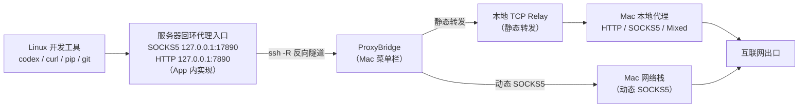

<div align="center">


# ProxyBridge

**在 Mac 菜单栏一键把本地代理「带」到 Linux 服务器**

[](https://github.com/fejxc/ProxyBridge/actions/workflows/ci.yml)
[](https://github.com/fejxc/ProxyBridge/releases/latest)
[](LICENSE)


通过系统 SSH 建立反向隧道，让服务器上的开发工具（Codex、curl、pip、git 等）直接使用 Mac 上已验证的 HTTP、SOCKS5 或 Mixed 代理出海；也支持 OpenSSH 原生反向动态 SOCKS5，兼容 Clash Network Extension / TUN 没有本地代理端口的场景。

[下载最新版](https://github.com/fejxc/ProxyBridge/releases/latest) · [更新日志](CHANGELOG.md) · [报告问题](https://github.com/fejxc/ProxyBridge/issues)

</div>

## 目录

- [功能特性](#-功能特性)
- [系统要求](#-系统要求)
- [安装](#-安装)
- [快速上手](#-快速上手)
- [连接模式](#-连接模式)
- [Linux 端使用](#-linux-端使用)
- [实时流量统计](#-实时流量统计)
- [工作原理](#-工作原理)
- [从源码构建](#-从源码构建)
- [项目文档](#-项目文档)
- [常见问题](#-常见问题)
- [安全说明](#-安全说明)
- [参与贡献](#-参与贡献)
- [许可证](#-许可证)

## ✨ 功能特性

### 连接与隧道

- 通过系统 `/usr/bin/ssh` 建立真实的 `ssh -R` 隧道，远端监听只绑定服务器自身 `127.0.0.1`。
- 三种连接模式：自动（推荐）、传统静态端口转发、OpenSSH 原生反向动态 SOCKS5；自动模式先实测本地入口，无可用入口时回退动态 SOCKS5。
- 本地代理端点动态跟随：端口漂移、代理客户端重启后实测新端点并无缝切换转发目标，SSH 隧道不中断，并按新协议重验远端；本地验证失败会主动重扫。
- 代理节点切换自动感知：经出口 IP 指纹观测节点切换，IP 变化即自动重验活跃隧道的远端代理。

### 智能自愈

- 非人为断开自动重连（默认开启）：网络故障按 1、2、4…秒退避重试，最多等待 60 秒；网络恢复、睡眠唤醒后立即重建；本地 / 远端 / Relay 端口冲突在 3 分钟窗口内自动重试，远端冲突支持经 SSH 只读诊断占用进程。
- 自动模式回退动态 SOCKS5 后，本地代理恢复验证即自动切回静态转发。
- 单实例保护与崩溃孤儿 ssh 进程清扫，避免双开和残留隧道抢占端口。

### 安全与隐私

- SSH 强制 `StrictHostKeyChecking=yes`；首次连接在应用内核对主机指纹并信任（无需先开终端），主机密钥变化不提供一键覆盖；支持从 `~/.ssh/config` 导入服务器。
- 支持 HTTP、SOCKS5、Mixed 上游，密码、ssh-agent 与指定私钥。密码经 OpenSSH 原生 SSH_ASKPASS 机制交付（不经命令行参数、环境变量或日志）；勾选「记住」时存入 macOS 钥匙串；认证成功后密码在会话内记忆，自动重连不再重复询问。
- 日志脱敏，不记录密码、密钥内容或完整认证信息。

### 状态可观测

- 分项显示实际连接模式、SSH、Mac 出站、Linux SOCKS5、HTTP CONNECT 验证与错误原因；只有远端真实请求通过后才报告代理可用，Clash 出站节点单独标记为未确认。
- 每台服务器可配置业务验证目标，「已连接」结论明确标注实际探测目标，仅代表该目标可达。
- 静态转发模式提供实时流量统计与速率曲线（见[下文](#-实时流量统计)）。
- 日志写入 `~/Library/Logs/ProxyBridge/app.log`（超 2MB 轮转），应用内可一键定位。

### 体验

- 应用内自动更新：流式下载 + 独立签名完整性校验 + 原子替换，任一校验不过绝不安装，失败自动回滚。
- 启动检查更新（只读 GitHub 公开接口）、系统登录项、启动时连接选定服务器、连接异常通知、可选「连接期间防止空闲休眠」。
- 默认在 Linux `127.0.0.1:7890` 提供 Codex HTTP 兼容入口，由 App 在 Mac 侧实现（远端零依赖，无需安装任何软件）。App 不使用 sudo、不修改系统配置或 sshd，用户可关闭该入口。
- 界面支持中文 / English。

## 📦 系统要求

| 位置 | 要求 |
|---|---|
| Mac | macOS 14 及以上，Apple Silicon 或 Intel |
| Mac 侧代理 | 已在本地验证可用的 HTTP / SOCKS5 / Mixed 回环入口；Clash 使用 Network Extension / TUN 无本地端口时，使用动态 SOCKS5 |
| Linux 服务器 | 可 SSH 登录的普通用户账号；`curl`（用于真实探测）。HTTP 兼容入口由 App 内实现，服务器零依赖 |
| 仅构建需要 | 完整 Xcode 15+，或仅 Command Line Tools（Swift 6.0 编译器），见[从源码构建](#-从源码构建) |

## 🚀 安装

1. 前往 [Releases](https://github.com/fejxc/ProxyBridge/releases/latest) 下载 `ProxyBridge-<版本号>-universal.dmg`（Apple Silicon 与 Intel 通用）。
2. 打开 DMG，将 **ProxyBridge.app** 拖入「应用程序」文件夹，双击启动。
3. 如果 macOS 阻止打开，确认文件来自本仓库 Release 后，按 [Apple 官方说明](https://support.apple.com/102445)在「系统设置 → 隐私与安全性」中允许打开。

> 当前 App 为 ad-hoc 签名，未经 Apple 公证。每台 Mac 都需要自行配置本地代理和服务器；安装包不包含任何配置、密码或私钥。

## ⚡ 快速上手

1. 如果使用传统静态转发，先在 Mac 上启动代理客户端并确认 HTTP、SOCKS5 或 Mixed 回环入口可用；Clash 使用 Network Extension / TUN 时，直接选「动态 SOCKS5」。
2. 启动 ProxyBridge，添加服务器并选择认证方式（可从 `~/.ssh/config` 导入）。主机指纹两种方式任选其一：
   - 首次连接时在应用内按引导核对指纹并写入 `known_hosts`（推荐，无需先开终端）；
   - 或先在终端手动登录一次：

   ```bash
   ssh -p <SSH端口> <用户名>@<服务器地址>
   ```

3. 点击「连接」。应用会显示最终实际模式，并从 Linux 服务器发起真实请求验证代理入口。动态 SOCKS5 会验证 Linux SOCKS 到 Mac 出站，这不能单独确认 Clash 具体命中的规则或节点，请在 Clash「活动」中核对。
4. 在服务器上按 [Linux 端使用](#-linux-端使用)配置环境变量，即可开始使用。

> 「启动后连接」和「登录时启动」是两个独立选项：前者决定哪些服务器在 App 启动后连接，后者决定 App 是否随 macOS 登录启动。登录项和通知均需按系统提示授权。

## 🔗 连接模式

| 模式 | 数据路径 | Linux 代理地址 |
|---|---|---|
| 自动（推荐） | 优先使用真实验证成功的本地 upstream；否则尝试 OpenSSH 反向动态 SOCKS5 | Codex HTTP `127.0.0.1:7890`（默认）；SOCKS5 `127.0.0.1:17890` |
| 传统端口转发 | Linux 回环 → SSH `-R remote:local` → Mac 的 HTTP/SOCKS/Mixed 上游 | 按上游协议使用 `remotePort` |
| 动态 SOCKS5 | Linux SOCKS5 → SSH `-R 127.0.0.1:port` → Mac 网络栈 | SOCKS5 `127.0.0.1:17890` |

动态模式使用 `ssh -R 127.0.0.1:<port>`，Mac 不需要本地 HTTP/SOCKS 监听；远端 SOCKS5 只支持 TCP。

## 🐧 Linux 端使用

连接成功后，在服务器上导出环境变量即可让开发工具走 Mac 代理。HTTP 兼容入口默认启用，底层 SOCKS5 使用独立端口 `17890`，Codex 等 HTTP 配置继续使用 `7890`：

```bash
export http_proxy=http://127.0.0.1:7890
export https_proxy=http://127.0.0.1:7890
export HTTP_PROXY=http://127.0.0.1:7890
export HTTPS_PROXY=http://127.0.0.1:7890
export NO_PROXY=localhost,127.0.0.1,::1
curl -I --proxy http://127.0.0.1:7890 \
  --connect-timeout 8 --max-time 20 https://api.openai.com/v1/models
```

未认证 API 通常返回 HTTP 401；这表示请求已经到达 API，不代表账号已认证。ProxyBridge 会单独验证 HTTP CONNECT。

HTTP 入口由 ProxyBridge 在 Mac 侧实现（经 SSH 反向隧道承载），服务器无需安装 Privoxy 或任何其他软件；远端 SSH 转发只绑定 `127.0.0.1`。端口冲突时请在服务器配置页改端口，应用不会终止未知进程；HTTP 入口可在服务器配置中关闭。

仅用 SOCKS5 时（curl 示例）：

```bash
curl --socks5-hostname 127.0.0.1:17890 -I \
  --connect-timeout 8 --max-time 20 https://api.openai.com/v1/models
```

想在 Mac 上手工复现动态 SOCKS5 隧道（先启动隧道，替换 SSH 信息和端口）：

```bash
ssh -N -T -o BatchMode=yes -o StrictHostKeyChecking=yes \
  -o ExitOnForwardFailure=yes -o ServerAliveInterval=30 -o ServerAliveCountMax=3 \
  -R 127.0.0.1:17890 <user>@<host>
```

## 📊 实时流量统计

静态转发模式内置本地 TCP Relay，链路为 `Linux → SSH → Mac Relay → 本地代理`。连接面板显示实际上传、下载速率及累计流量，展开可查看最近 60 秒曲线。上传指 Linux → Mac 本地代理，下载为反方向；只统计 Relay 成功转发的业务字节，包含代理健康检查，不包含 SSH 协议开销。断开保留本次累计量，重连开始新统计。动态 SOCKS5 模式不经过本地 Relay，面板会如实展示会话时长与无法统计业务字节的原因。

Relay 默认由系统分配空闲端口，仅监听 `127.0.0.1`。在服务器编辑窗口的「流量统计 Relay」中可指定固定端口（建议 17997）；端口占用时会停止连接并报告原因。实现与验收细节见[流量统计报告](docs/TRAFFIC-STATISTICS.md)。

## ⚙️ 工作原理

ProxyBridge 不内置代理协议实现：它启动一个真实的 `/usr/bin/ssh` 子进程，利用 OpenSSH 原生的远程转发能力把 Mac 侧网络「反向」提供给服务器。



- **静态转发**：App 在 Mac 本地启动 TCP Relay，把隧道流量原样送入已验证的本地代理入口，因此可以统计业务字节。
- **动态 SOCKS5**：使用 OpenSSH 原生「反向动态转发」，由 Mac 网络栈发起 TCP 出站，不依赖本地代理端口（因此兼容 Clash TUN / Network Extension 场景）；该路径不经过本地 Relay，不计业务流量统计。
- **HTTP 兼容入口**：由 App 内置的 HTTP 入口中继实现（服务器零依赖）——按实测上游协议自动选择透明管道、CONNECT 翻译或 Mac 直连三种模式。
- 全链路只绑定回环地址：远端监听只在服务器本机 `127.0.0.1`，本地 Relay 与 HTTP 入口也只监听 Mac 回环。

## 🛠 从源码构建

需要 Xcode 的 Mac：

```bash
open ProxyBridge.xcodeproj
bash scripts/xcode_test.sh
```

只有 Command Line Tools 时：

```bash
bash scripts/typecheck.sh       # App 与测试代码类型检查
bash scripts/smoke_test.sh      # 当前源码可执行回归检查
bash scripts/relay_test.sh      # 真实本地 TCP 转发、精度与清理验证
bash scripts/integration_test.sh # 集成测试：用户态 sshd 真隧道 6 场景（无需管理员）
bash scripts/install_app.sh     # 构建并安装到 /Applications
bash scripts/build_dmg.sh 1.7.1 # 构建通用 DMG 和 SHA-256 文件（参数为版本号）
```

推送 `vX.Y.Z` 格式的版本标签会触发 GitHub Actions：分别在 Apple Silicon 和 Intel runner 上检查，再构建和验证通用 DMG，最后发布 GitHub Release。详见[发布流程](docs/RELEASE.md)与 [BUILD.md](BUILD.md)。

## 📚 项目文档

| 文档 | 内容 |
|---|---|
| [BUILD.md](BUILD.md) | 构建环境、Xcode / 命令行两种路径与常见问题 |
| [CHANGELOG.md](CHANGELOG.md) | 每个版本的完整变更记录 |
| [KNOWN_LIMITATIONS.md](KNOWN_LIMITATIONS.md) | 已知限制与能力边界（以最新版本为准） |
| [docs/RELEASE.md](docs/RELEASE.md) | 版本发布流程（标签触发 CI 构建与发布） |
| [docs/TRAFFIC-STATISTICS.md](docs/TRAFFIC-STATISTICS.md) | 流量统计的实现与验收细节 |
| [docs/ACCEPTANCE-CHECKLIST.md](docs/ACCEPTANCE-CHECKLIST.md) | 发布前真实环境验收清单 |
| [docs/PROXYBRIDGE_V2_ACCEPTANCE.md](docs/PROXYBRIDGE_V2_ACCEPTANCE.md) | Linux / Clash 端到端验收报告 |

## ❓ 常见问题

| 问题 | 处理 |
|---|---|
| 打不开，提示无法验证开发者 | 见[安装](#-安装)第 3 步；App 为 ad-hoc 签名、未公证 |
| Clash 开了 TUN 模式，没有本地代理端口 | 使用「动态 SOCKS5」或「自动」模式，无需本地端口 |
| 重连时反复要求输入密码 | 认证成功后密码在会话内自动记忆；跨会话复用请勾选「记住密码」（存入钥匙串） |
| 流量面板没有数据 | 动态 SOCKS5 模式不经过本地 Relay，无法统计业务字节，属如实展示 |
| 菜单栏看不到图标 | 见 [BUILD.md 常见问题](BUILD.md#常见问题) |

更多能力边界与待验收项见 [KNOWN_LIMITATIONS.md](KNOWN_LIMITATIONS.md)。

## 🔒 安全说明

SSH 强制 `StrictHostKeyChecking=yes`，远端只监听服务器本机回环地址，本地 Relay 同样只绑定 `127.0.0.1`。认证密码不会进入 SSH 参数、环境变量或应用日志。请勿通过更改 SSH 主机密钥检查或开放公网监听来排障。

应用支持 macOS 14 及以上版本。动态 SOCKS5 通过 SSH 客户端的 Mac 网络栈发起 TCP 出站，不承诺 UDP、透明系统代理或 Clash 节点路由；远端代理不对 LAN 或公网开放。完整安全边界与端到端验收结果见[已知限制](KNOWN_LIMITATIONS.md)、[验收报告](docs/PROXYBRIDGE_V2_ACCEPTANCE.md)与[阶段 D 报告](docs/PHASE_D_REPORT.md)。

## 🤝 参与贡献

欢迎通过 [Issue](https://github.com/fejxc/ProxyBridge/issues) 与 Pull Request 参与贡献。

- **报告问题**：请附复现步骤、连接模式与代理客户端类型，以及应用日志（`~/Library/Logs/ProxyBridge/app.log`，App 已内置脱敏）。
- **提交代码**：
  1. Fork 仓库并创建特性分支；
  2. 本地验证通过后再提交——有完整 Xcode 时运行 `bash scripts/xcode_test.sh`，仅有 Command Line Tools 时运行 `bash scripts/typecheck.sh && bash scripts/smoke_test.sh`；
  3. 提交信息使用约定式前缀（本仓库惯例：`feat:` / `fix:` / `test:` / `docs:` / `ci:` / `release:`）。
- **安全底线**：不接受放宽 SSH 主机密钥校验、开放公网监听或绕过更新完整性校验的改动。
- 文档改进、翻译，以及不同 Linux 发行版 / 代理客户端下的真实环境验收反馈同样欢迎。

## 📄 许可证

本项目基于 [MIT License](LICENSE) 开源。使用、修改与分发请遵循许可证条款；软件按「现状」提供，不附带任何担保。
